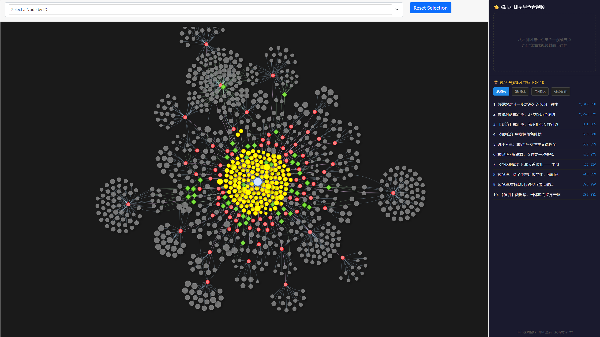

# B站视频关系图谱生成器

一个将B站视频数据转换为交互式关系图谱的可视化工具。

## 版本说明

项目提供两个版本：

- **V1版本**：简单直接，适合快速开发
- **V2版本**：配置驱动，适合长期维护（推荐）

详细对比请查看 [V1_vs_V2对比.md](V1_vs_V2对比.md)

## 快速开始

### V2版本（推荐）

```bash
# 1. 安装依赖
pip install -r requirements.txt

# 2. 采集数据
python crawl_v2.py

# 3. 生成图谱
python run_v2.py

# 4. 查看结果
# 打开 output/graph_v2.html
```

### V1版本

```bash
# 1. 安装依赖
pip install -r requirements.txt

# 2. 采集数据
python crawl.py

# 3. 生成图谱
python run_enhanced.py

# 4. 查看结果
# 打开 output/graph_enhanced.html
```

### 3. 生成图谱

基础版：
```bash
python run.py
```

增强版（推荐）：
```bash
python run_enhanced.py
```

然后打开 `output/graph.html` 或 `output/graph_enhanced.html` 查看结果。

增强版特性：
- ✨ 右侧边栏：视频详情、封面、统计数据
- 🏆 TOP 10排行榜：总播放、赞/播比、币/播比、综合转化
- 🎯 点击节点查看详情，双击跳转B站

## 项目结构

### V2版本（推荐）

```
bili-take-tree/
├── config/                         # 配置文件（V2新增）
│   ├── node_config.json           # 节点样式配置
│   └── graph_schema.json          # 数据格式规范
├── src/                            # 核心代码
│   ├── data_processor_v2.py       # 数据处理器V2
│   ├── graph_generator_v2.py      # 图谱生成器V2
│   ├── graph_template_v2.html     # 模板V2
│   ├── bilibili_crawler_v2.py     # 采集器V2
│   └── ...                        # V1版本文件
├── data/                           # 数据目录
│   ├── graph_data_v2.json         # 图谱数据（V2格式）
│   ├── videos.csv                 # 原始数据（V1格式）
│   └── ...
├── output/                         # 输出目录
│   ├── graph_v2.html              # V2版本图谱
│   ├── graph_enhanced.html        # V1增强版图谱
│   └── ...
├── docs/                           # 文档目录
│   ├── V2版本优化说明.md          # V2版本说明
│   └── ...
├── run_v2.py                       # V2运行脚本
├── crawl_v2.py                     # V2采集工具
└── V1_vs_V2对比.md                 # 版本对比
│   ├── 使用说明.md         # 使用指南
│   ├── RPA采集指南.md      # 数据采集指南
│   └── 项目总结.md         # 项目总结
├── ref/                     # 参考资料
│   ├── 戴锦华_侧边栏增强版图谱.html  # 原项目参考
│   └── prompt.txt          # 对话记录
├── run.py                   # 主运行脚本
├── test_demo.py            # 演示脚本
└── requirements.txt        # Python依赖

```

## 功能特性

- ✅ 使用B站公开API自动采集数据
- ✅ 交互式命令行界面
- ✅ 支持关键词搜索和BV号列表采集
- ✅ 多层级节点关系（核心-UP主-视频）
- ✅ 根据播放量动态调整节点大小
- ✅ 交互式操作（拖拽、缩放、搜索）
- ✅ 点击高亮相关节点
- ✅ 双击跳转B站
- ✅ 字幕标识（绿色边框）
- ✅ 自动布局算法

## 文档

- 📖 [详细说明](docs/README.md) - 完整的项目介绍
- 🚀 [快速导航](docs/快速导航.md) - 快速找到你需要的内容
- 🤖 [API使用说明](docs/API使用说明.md) - B站API采集指南
- 📝 [使用说明](docs/使用说明.md) - 详细的使用指南
- 📊 [项目总结](docs/项目总结.md) - 技术总结和优化方向
- 📁 [项目结构说明](docs/项目结构说明.md) - 目录结构详解

## 技术栈

- Python 3.7+
- Pandas - 数据处理
- Jinja2 - 模板引擎
- vis.js - 网络图可视化
- Bootstrap 5 - UI框架

## 数据格式

采集器会自动生成标准格式的CSV文件：

```csv
bv_id,title,up_name,publish_date,play_count,coin_count,duration,has_subtitle
BV1234567890,视频标题,UP主名称,2024-01-01,10000,500,3600,是
```

详见 [API使用说明](docs/API使用说明.md)

## 示例效果



## 许可证

本项目供学习和研究使用。

## 致谢

- 原项目创意和实现
- vis.js 可视化库
- B站内容平台
